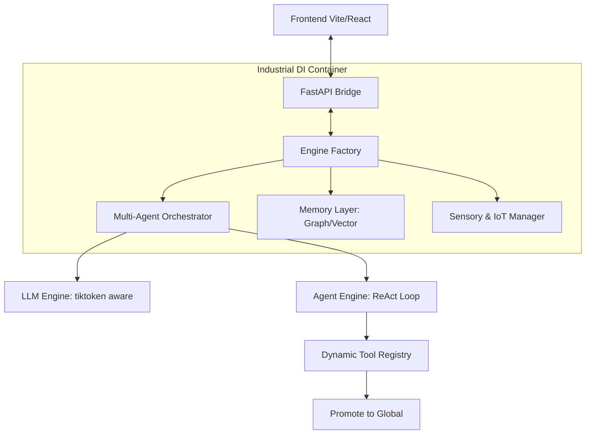

# Alana System: Industrial Multi-Agent Engineering Ecosystem


**Alana System** é um ecossistema de engenharia de agentes autônomos de próxima geração, projetado para orquestração de tarefas complexas, síntese de conhecimento técnico e evolução contínua de fluxos agentais. Construído sob uma arquitetura de nível industrial, o sistema implementa um loop multi-agente resiliente capaz de resolver problemas técnicos de alta complexidade com verificação autônoma e segurança rigorosa.

---

## 🏗️ Núcleo Arquitetural
*   **Multi-Agent Orchestrator (M.A.O.)**: Implementa um padrão "Blackboard" sofisticado onde agentes especialistas (Librarian, Engineer, Auditor) colaboram em um estado de missão unificado.
*   **AgentEngine (O Cérebro)**: Um loop ReAct de alta precisão com gestão de contexto baseada em tokens reais (`tiktoken`) e sanitização de código via AST para execução segura.
*   **Industrial DI (AlanaContainer)**: Container de Injeção de Dependências centralizado que gerencia o ciclo de vida de mais de 20 motores especializados, garantindo modularidade e testabilidade de elite.

## 🧠 Inteligência e Memória
*   **Sistema de Memória Híbrido**: Combina busca vetorial semântica (**Qdrant**) com conhecimento estrutural em grafos (**SQLite/WAL**) para recuperação profunda de contexto.
*   **Episodic Experience Store**: Captura e "imortaliza" estratégias vencedoras de missões passadas, permitindo que o sistema aprenda com sucessos e evite falhas recorrentes.
*   **Auto-Evolução (Self-Tooling)**: Capacidade de gerar novas ferramentas Python em tempo real, com um mecanismo de **Promoção Global** para elevar capacidades locais ao escopo de todo o ecossistema.

---

## 🛠️ Stack Tecnológica de Elite
- **Core Engine:** Python 3.11+ (Asyncio nativo para I/O não-bloqueante).
- **Inference Layer:** Orquestração híbrida entre **Ollama (Llama 3.1/3.2 local)** e **Google Gemini 2.0 Flash**.
- **Context Management:** Precisão cirúrgica via **tiktoken** com compressão inteligente de histórico.
- **Frontend:** Dashboard moderno em **React + Vite + TypeScript** com visualização de grafos.
- **Observability:** Logging estruturado com propagação de **Trace IDs** em tarefas de background.

---

## 🚀 Diferenciais Técnicos (Inovação Industrial)

### 1. Higiene de Contexto por Tokens 🧠
Diferente de sistemas que cortam mensagens aleatoriamente, a Alana monitora o uso real da janela de contexto. Ao atingir 70% da capacidade, o sistema dispara autonomamente uma sumarização técnica do progresso, garantindo que o objetivo da missão nunca seja perdido por estouro de memória.

### 2. The Tool Maker & Evolution 🌟
A Alana possui a capacidade de **Metacognição de Ferramentas**. Caso encontre uma lacuna técnica, ela utiliza o `SynthesizeTool` para gerar novos módulos. Ferramentas validadas podem ser promovidas para o nível **GLOBAL**, permitindo que o sistema evolua suas capacidades permanentemente.

### 3. O Efeito Anti-Borboleta (Knowledge Catalyst) 🌱
Implementação de Teoria do Caos aplicada ao conhecimento. O sistema identifica matematicamente "ilhas isoladas" no grafo e propõe "Pontes Semânticas" para maximizar a densificação do saber e reduzir o caminho médio entre conceitos.

---

## 🏗️ Arquitetura do Sistema



---

## 📁 Estrutura do Projeto
```text
Alana_System/
├── src/alana_system/
│   ├── agent/            # Orquestração, Engines e Tools (Self-Tooling)
│   ├── api/              # Rotas modulares (Admin, Chat, Agent, System)
│   ├── core/             # Container DI (factory.py), Config e Log Context
│   ├── inference/        # Motores LLM (tiktoken integration)
│   ├── memory/           # GraphStore, VectorStore e Intelligence
│   └── utils/            # Tarefas de background e monitoramento
├── data/                 # Sandbox de agentes, Artefatos e Memória
├── frontend/             # Interface React/TypeScript (Vite)
├── tests/                # Suítes Industriais e de Evolução
└── bridge.py             # Ponto de Entrada (Industrial Lifespan)
```

---

## 📦 Características de Nível Enterprise
- **Namespace Isolation:** Isolamento rigoroso de dados e ferramentas por projeto/cliente.
- **Security First:** Sanitização baseada em AST e proteção contra Path Traversal.
- **Human-in-the-Loop:** Fila de aprovação para planos complexos antes da execução.

---

## 📝 Conclusão
O Alana System é um **Laboratório de Engenharia Autônoma**. Representa o estado da arte na união de sistemas simbólicos (Grafos) com conexistas (LLMs), focado em performance, escalabilidade e robustez técnica inegociável.
